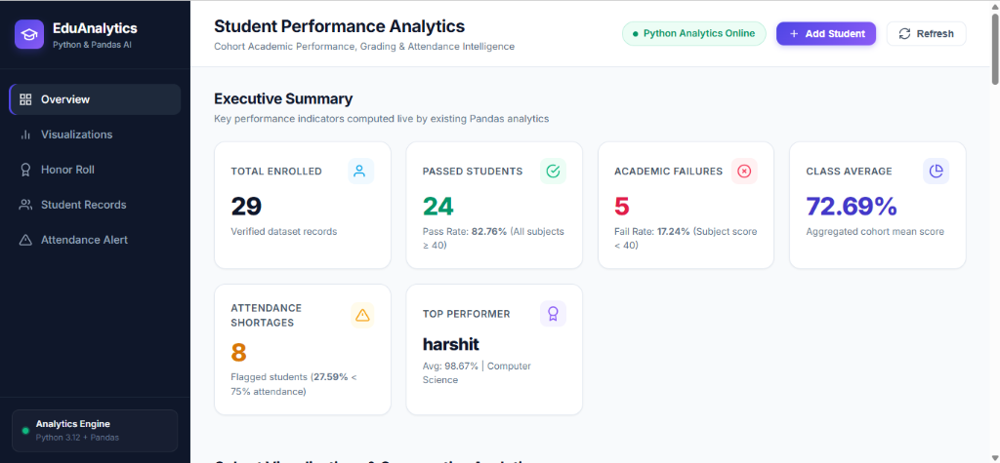
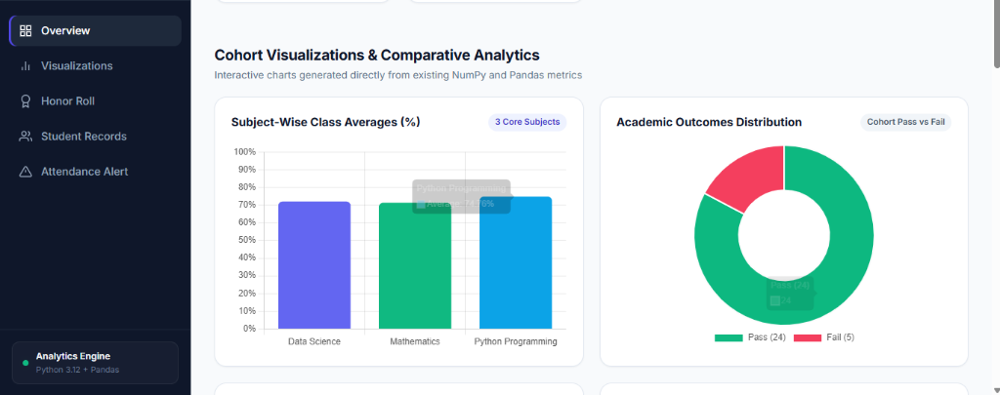
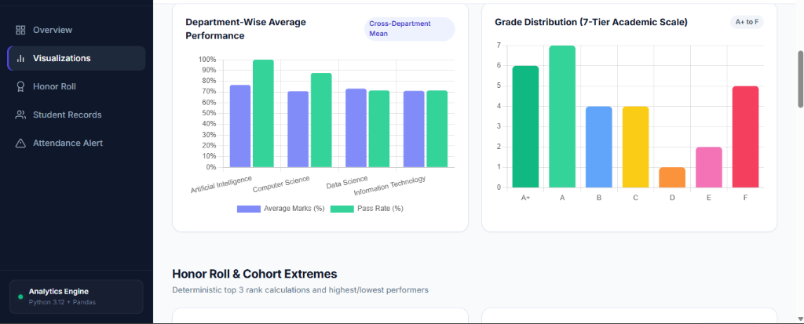
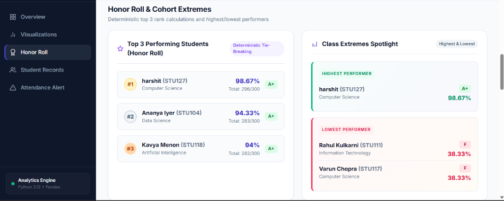
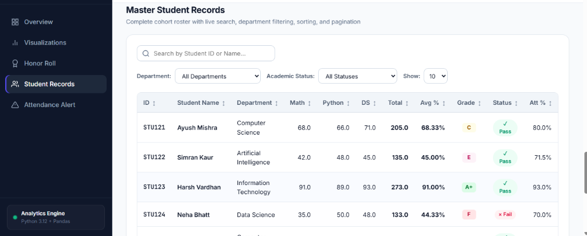

# Student Performance Analytics System
## Comprehensive Project Documentation & Technical Report

**Course**: Python with AI  
**Project**: Mini Project — Student Performance Analytics System  
**Version**: 1.0.0  
**Technology Stack**: Python 3.12+, Pandas, NumPy, Flask, JavaScript, HTML5/CSS3  
**Repository**: [https://github.com/Ashishmaurya1303/Ashishmaurya1303-student-performance-analytics-system](https://github.com/Ashishmaurya1303/Ashishmaurya1303-student-performance-analytics-system)  
**Author**: Ashish Maurya (Ashishmaurya1303)  

> 📄 **Official PDF Document**: [Download Project_Documentation.pdf](Project_Documentation.pdf)  
> 📖 **Quick Start & Setup Guide**: [View README.md](README.md)

---

## 1. Title Page & Metadata
- **Project Title**: Student Performance Analytics System
- **Domain**: Educational Data Science & Academic Analytics
- **Primary Modules**: `data_loader`, `analytics`, `display`, `main`
- **Submission Date**: October 2026

---

## 2. Abstract
The **Student Performance Analytics System** is a modular, high-integrity educational analytics application developed in Python using Pandas and NumPy. It automates the end-to-end processing of student academic records, starting from CSV ingestion and data validation, through mathematical computations of scores, percentages, letter grades, pass/fail status, and attendance evaluations, to structured terminal-based executive reporting. The system enforces strict academic policies, such as per-subject passing cutoffs and median-based missing-value handling, delivering reliable insights for academic coordinators and faculty.

---

## 3. Project Objective
The key objectives of this project are:
1. Ingest real-world student academic and attendance data from a standardized CSV file.
2. Provide automated data cleansing, validation, and transparent median imputation for missing or corrupted records without modifying the original source file.
3. Apply vectorized computations using Pandas and NumPy to determine individual totals, percentages, letter grades, pass/fail status, and attendance warnings.
4. Calculate aggregate cohort metrics including subject-wise averages, overall class average, and performance extremes (highest and lowest scores).
5. Produce an accessible, cleanly aligned terminal report for academic monitoring.
6. Establish a comprehensive automated unit and integration testing suite to ensure determinism and zero regressions.

---

## 4. Problem Statement
Educational institutions often handle student grade sheets manually or across disconnected spreadsheets, leading to:
- Calculation errors in aggregate marks and percentages.
- Inconsistent grade assignment and failure to enforce strict individual subject minimums.
- Inability to quickly identify students with critical attendance shortages (< 75%).
- Vulnerability to missing, corrupted, or out-of-range grade entries.

This project delivers an automated, transparent, and reproducible command-line tool that eliminates manual errors and presents actionable cohort summaries in seconds.

---

## 5. Technologies Used
- **Python (v3.12+)**: Core programming language utilizing clean modular architecture, type hints, and PEP 8 guidelines.
- **Pandas**: Used for robust CSV ingestion, schema validation, Series/DataFrame operations, and tabular data structuring.
- **NumPy**: Powers vectorized numerical calculations (`np.select`, `np.where`, array comparisons) and aggregate metrics.
- **Standard Library**:
  - `pathlib.Path`: Cross-platform filesystem navigation and path resolution.
  - `sys`: System path manipulation and standard exit codes.
- **ReportLab / Pillow**: Used for automated generation of publication-ready PDF documentation and screenshot rendering.

---

## 6. System Architecture and Workflow

```
[ Raw CSV Dataset: data/students.csv ]
                   │
                   ▼
       [ 1. Data Loading Module ] (src/data_loader.py)
         - File existence & schema validation
         - Empty file & corrupt format handling
                   │
                   ▼
       [ 2. Data Cleaning & Validation ] (src/data_loader.py)
         - Strip text whitespace
         - Detect empty names & duplicate student IDs
         - Validate numeric range [0.0 - 100.0]
         - Documented median imputation for missing values
                   │
                   ▼
       [ 3. Analytics Engine ] (src/analytics.py)
         - Calculate Totals & Percentages
         - Apply Passing Criteria (Per-subject & Aggregate)
         - Vectorized Letter Grade Assignment (A+ to F)
         - Attendance Status Evaluation (< 75% Shortage)
         - Cohort Aggregates & Deterministic Rankings
                   │
                   ▼
       [ 4. Presentation & Reporting ] (src/display.py)
         - Formatted Console Table Roster
         - Top 3 Honor Roll
         - Class Extremes (Highest & Lowest)
         - Subject & Class Averages
         - Attendance Shortage Advisory
         - Executive Summary
```

---

## 7. Dataset Description
The system operates on [`data/students.csv`](file:///e:/Python%20with%20ai/student_analytics_system/data/students.csv), containing 26 realistic student records across 4 academic departments.

| Column Name | Data Type | Description | Valid Constraints |
| :--- | :--- | :--- | :--- |
| `student_id` | String | Unique student identifier | Non-empty, unique |
| `student_name` | String | Full student name | Non-empty text |
| `department` | String | Academic department (CS, AI, IT, DS) | Valid department name |
| `math_marks` | Float | Score in Mathematics | 0.0 to 100.0 |
| `python_marks` | Float | Score in Python Programming | 0.0 to 100.0 |
| `data_science_marks` | Float | Score in Data Science | 0.0 to 100.0 |
| `attendance_pct` | Float | Attendance percentage | 0.0 to 100.0 |

---

## 8. Functional Requirements & Project Modules

### A. Module `src/data_loader.py`
- `load_data(file_path)`: Validates file presence, non-zero size, parseability, and required column schema.
- `clean_data(df)`: Preserves input immutability via deep copying, normalizes strings, detects duplicate IDs, validates numeric ranges, and executes transparent median imputation.

### B. Module `src/analytics.py`
- `calculate_total_marks(df)`: Vectorized row-wise sum across subjects.
- `calculate_average_marks(df)`: Row-wise mean rounded to 2 decimal places.
- `determine_pass_fail(df)`: Evaluates $\ge 40$ in all individual subjects AND $\ge 40\%$ average.
- `assign_grades(df)`: Implements standard 7-tier academic grading rules.
- `evaluate_attendance(df)`: Assigns 'Normal' ($\ge 75\%$) or 'Shortage' ($< 75\%$).
- `calculate_subject_averages(df)` & `calculate_overall_average(df)`: Class aggregate scores.
- `get_top_students(df, n=3)`: Deterministic top rank extraction.
- `get_highest_performing(df)` & `get_lowest_performing(df)`: Identifies cohort extremes.
- `get_performance_summary(df)`: Statistical counts and percentages.

### C. Module `src/display.py`
- Provides formatted ASCII tables, section headers, warning blocks, and aligned columns optimized for standard terminals.

### D. Module `main.py`
- Application orchestrator resolving relative paths, coordinating data flow, trapping exceptions gracefully, and returning standard POSIX exit codes.

---

## 9. Implementation Details
- **Immutability Principle**: Input DataFrames are never mutated in place. All transformation functions return fresh copies.
- **Deterministic Tie-Breaking**: When two students tie in average marks, ranking priority resolves by `total_marks` $\rightarrow$ `math_marks` $\rightarrow$ `python_marks` $\rightarrow$ `data_science_marks` $\rightarrow$ `student_id`.
- **Missing Value Policy**: Out-of-bounds numbers (< 0 or > 100) are treated as invalid and imputed with the column median of valid values.
- **Cross-Directory Execution**: File paths are dynamically resolved via `Path(__file__).resolve().parent`, allowing `main.py` to run regardless of the user's active working directory.

---

## 10. Grading and Pass/Fail Rules

### Academic Passing Rules
- **Individual Subject Passing Minimum**: Score $\ge 40.0$ in Mathematics, Python, and Data Science individually.
- **Aggregate Minimum**: Overall Average $\ge 40.0\%$.
- If either condition is unmet, status is **Fail** and grade is **F**.

### Grading Scale (For Passing Students)
- $\ge 90.0\%$: **A+** (Outstanding)
- $80.0\% - 89.9\%$: **A** (Excellent)
- $70.0\% - 79.9\%$: **B** (Very Good)
- $60.0\% - 69.9\%$: **C** (Good)
- $50.0\% - 59.9\%$: **D** (Satisfactory)
- $40.0\% - 49.9\%$: **E** (Pass)
- $< 40.0\%$ (or failed any subject): **F** (Fail)

### Attendance Standard
- $\ge 75.0\%$: **Normal**
- $< 75.0\%$: **Shortage** (Flagged in advisory report)

---

## 11. Testing Methodology and Actual Test Results

Three dedicated test suites were implemented and executed:

| Test Suite | File | Tests Run | Result |
| :--- | :--- | :---: | :---: |
| Data Loader Unit Tests | `tests/test_data_loader.py` | 10 | 10 Passed, 0 Failed |
| Analytics Unit Tests | `tests/test_analytics.py` | 11 | 11 Passed, 0 Failed |
| End-to-End Integration Tests | `tests/test_end_to_end.py` | 6 | 6 Passed, 0 Failed |

### Summary of Validated Scenarios
- TC-01 to TC-04: Dataset loading, schema completeness, record volume, and numeric precision.
- TC-05 to TC-07: Missing value median imputation, out-of-range bounds checking, duplicate student ID detection.
- TC-08 to TC-10: Non-existent file handling, schema mismatch errors, and DataFrame immutability.
- TC-11 to TC-15: Exact grade boundary evaluation (90, 80, 70, 60, 50, 40, <40), single-subject failure override.
- TC-16 to TC-21: Attendance threshold sensitivity (74.5% vs 75.0%), ranking tie-breaking, cohort extremes, and pipeline resilience.

---

## 12. Program Execution & Web Dashboard Screenshots

The following authentic screenshots demonstrate the live interactive dashboard powered by the Python Flask, Pandas, and NumPy backend:

### 1. Executive Summary & Live KPI Overview
Key performance indicators computed live from the verified dataset records:


### 2. Subject-Wise Class Averages & Academic Outcomes Distribution
Interactive bar chart comparing subject averages alongside the cohort pass/fail donut visualization:


### 3. Department-Wise Average Performance & 7-Tier Grade Distribution
Comparative cross-department metrics and academic grade distribution from A+ to F:


### 4. Honor Roll (Top 3 Performers) & Cohort Extremes Spotlight
Deterministic top ranking with tie-breaking rules and class extremes spotlight:


### 5. Master Student Records Table
Searchable, filterable, and paginated student records roster with live status badges:


---

## 13. Results and Discussion
Running the analytics pipeline on the 29-student cohort yielded the following verified findings:
- **Total Enrolled**: 29 students
- **Passed**: 24 students (82.76%)
- **Academic Failures**: 5 students (17.24%)
  - `STU107` Vikram Singh (Failed Math: 34.0)
  - `STU111` Rahul Kulkarni (Failed Math: 38.0, Python: 35.0)
  - `STU117` Varun Chopra (Failed Math: 30.0)
  - `STU124` Neha Bhatt (Failed Math: 35.0)
  - `STU128` ashish (Failed Data Science: 35.0)
- **Top Performers (Honor Roll)**:
  1. `STU127` harshit (Computer Science) — Average: 98.67%, Grade: A+
  2. `STU104` Ananya Iyer (Data Science) — Average: 94.33%, Grade: A+
  3. `STU118` Kavya Menon (Artificial Intelligence) — Average: 94.00%, Grade: A+
- **Class Extremes**:
  - Highest Performer: harshit (98.67%, Total: 296.0/300)
  - Lowest Performers (tied): Rahul Kulkarni (38.33%) and Varun Chopra (38.33%)
- **Subject Class Averages**:
  - Python Programming: 74.76% (Highest subject average)
  - Data Science: 72.03%
  - Mathematics: 71.28%
- **Overall Class Average**: 72.69%
- **Attendance Shortage**: 8 students (27.59%) flagged with attendance $< 75.0\%$.

---

## 14. Challenges Faced and Lessons Learned
1. **Preserving Immutability**: Ensuring functions do not modify DataFrames in place required diligent use of `.copy(deep=True)`.
2. **Vectorized Boolean Logic**: Complex rules (e.g. passing requiring both individual subject cutoffs and overall averages) were optimized using `np.select` and bitwise operator chaining (`&`).
3. **Deterministic Tie-Breaking**: Standard ranking can cause unstable orders; multi-key hierarchical sorting resolved this reliably.
4. **Transparent Imputation**: Converting invalid out-of-range marks to `NaN` and imputing with the valid median while notifying the console provided transparent auditability.

---

## 15. Limitations and Future Enhancements
- **Current Limitations**:
  - Terminal-only output; lacks interactive web or GUI interface.
  - CSV-only storage; no relational database backend.
- **Future Enhancements**:
  - Integration with SQLite or PostgreSQL for persistent database storage.
  - Visualization dashboards using Matplotlib/Seaborn for mark distributions.
  - Export capabilities to Excel (`.xlsx`) and PDF report cards for individual students.

---

## 16. Conclusion
The **Student Performance Analytics System** successfully demonstrates the practical application of Python, Pandas, and NumPy for educational data analytics. By adhering to modular software engineering principles, automated testing, and defensive data cleaning, the system reliably automates grading and reporting while preventing data integrity errors.

---

## 17. GitHub Repository & Submission Information
- **GitHub Repository URL**: [https://github.com/Ashishmaurya1303/Ashishmaurya1303-student-performance-analytics-system](https://github.com/Ashishmaurya1303/Ashishmaurya1303-student-performance-analytics-system)
- **Author / Student**: Ashish Maurya (`Ashishmaurya1303`)
- **Documentation Artifacts**:
  - Markdown Report: [`Project_Documentation.md`](Project_Documentation.md)
  - Compiled PDF Report: [`Project_Documentation.pdf`](Project_Documentation.pdf)
  - Project Readme: [`README.md`](README.md)
